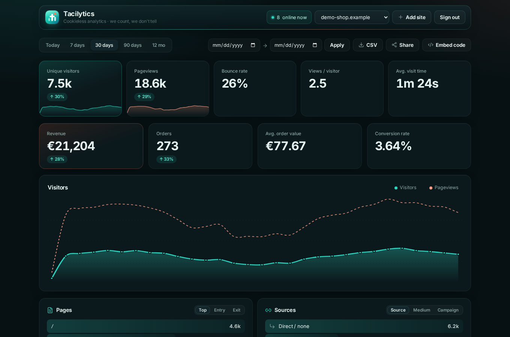
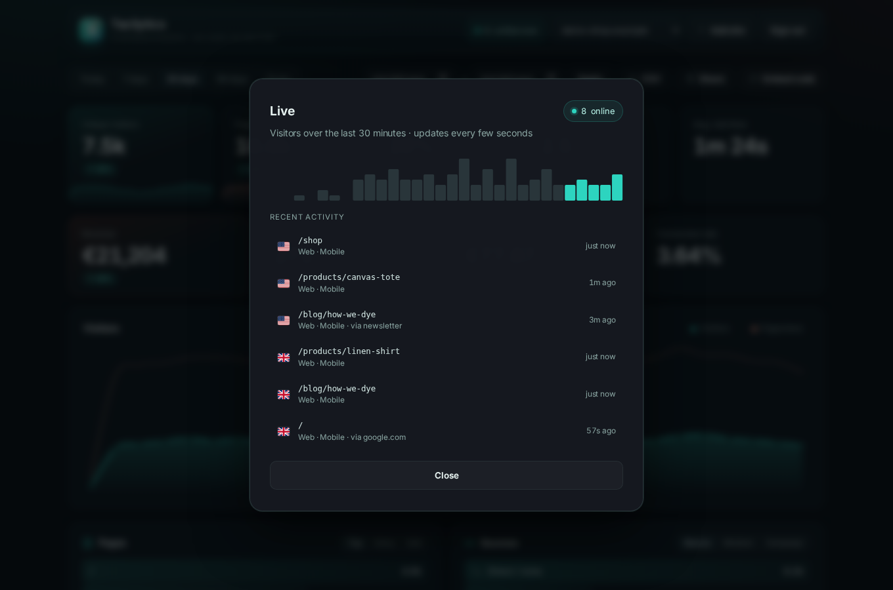

<div align="center">


# Tacilytics

**Privacy-first, cookieless analytics for websites and apps — self-hosted in minutes.**
*Tacit* (adj.): understood without being said. Tacilytics counts what matters and keeps quiet about who did it — one tiny script, one Node process, one SQLite file. No cookies, no consent banner, no creepy tracking. (And in Italian, *taci* simply means "be quiet".)

> Formerly **Nyx Analytics**. Existing installs keep working: `/nyx.js`, `window.nyx()` and the old Flutter class names are still supported as aliases.

[](LICENSE)




</div>

---

## Why Tacilytics

- 🍪 **Cookieless & banner-free.** No cookies, no `localStorage`, no fingerprinting — nothing to consent to.
- 🛡️ **IPs are never stored.** Unique visitors are counted with a *daily, salted, one-way hash* that’s irreversible and rotated every day.
- 🌍 **Region from the browser timezone**, never from IP geolocation.
- 🔍 **Segment everything.** Click any country, page, source, browser or campaign to filter the whole dashboard — stacked, with one-click chips.
- 🚦 **Campaigns & funnels.** Full UTM (`source` / `medium` / `campaign`), entry & exit pages, **goal conversion rates** and **custom event properties**.
- ⏱️ **Engagement time** — average time-on-page, measured privately (visible seconds only, no extra identifier).
- 🤖 **Bots & crawlers dropped** automatically, so your numbers stay honest.
- ⚡ **~2 KB tracker**, SPA-aware (tracks `pushState` / `popstate` route changes), optional **DNT / Global Privacy Control** honoring.
- 🗓️ **Data minimisation built in** — optional auto-purge of raw events after a retention window you choose.
- 🎯 **Custom events & goals**, **live visitors**, **trends**, **custom date ranges**, **CSV export**.
- 🛰️ **Agent-ready:** a clean `/api/v1` REST API (with segmentation params) + a `tacilytics` CLI (with `--json`).
- 🗄️ **Zero infra:** Express + SQLite. No Redis, no ClickHouse, no cloud.

## Quick start

**With npm** (fastest):

```bash
mkdir my-analytics && cd my-analytics
npx tacilytics serve      # http://127.0.0.1:3920 — data/ and .env live in this folder
```

Or install it globally: `npm i -g tacilytics`, then `tacilytics serve`.
Set your own `WEB_PASSWORD`, `SESSION_SECRET`, `INGEST_SALT` and `API_KEY` in a `.env` file in that folder (see [`.env.example`](.env.example)).

**From source:**

```bash
git clone https://github.com/Open-Cosmic-Software/tacilytics.git
cd tacilytics
npm install
cp .env.example .env     # set WEB_PASSWORD, SESSION_SECRET, INGEST_SALT, API_KEY
npm start                # http://127.0.0.1:3920
```

The server binds to `127.0.0.1` — put TLS in front. Example **Caddy**:

```
analytics.example.com {
    encode gzip
    reverse_proxy 127.0.0.1:3920
}
```

Open the dashboard, log in, click **+ Add site**, and drop the snippet into your `<head>`:

```html
<script defer data-domain="example.com" src="https://analytics.example.com/tacilytics.js"></script>
```

That’s it. Pageviews start flowing in — no cookie banner required.

## Custom events, goals & properties

Track conversions from anywhere in your code — optionally with **properties** to break them down:

```js
tacilytics('Signup');
tacilytics('Upgrade', { plan: 'pro' });
tacilytics('Purchase', { plan: 'pro', amount: '49' });
```

Goals show up in the **Goals & conversions** panel with a **conversion rate** (% of visitors). Click a goal to drill into it — the whole dashboard re-segments to converters, and each property’s top values appear as their own breakdown. Pageviews stay separate, so your view counts stay clean.

## Segment everything

Click any row — a country, page, source, browser, OS, device, language or campaign — to **filter the entire dashboard** to that segment. Filters stack and show as removable chips. The same segmentation is available over the API and CLI:

```bash
tacilytics stats example.com 30d --country=DE --source=twitter.com
curl -H "Authorization: Bearer $TACILYTICS_API_KEY" \
  "https://analytics.example.com/api/v1/stats?site=example.com&period=30d&country=DE&medium=email"
```

## Campaigns, entry/exit & engagement

- **UTM campaigns** — `utm_source` / `utm_medium` / `utm_campaign` are captured automatically; switch the Sources panel between **Source / Medium / Campaign**.
- **Entry & exit pages** — switch the Pages panel between **Top / Entry / Exit** to see where visits start and end.
- **Engagement time** — the tracker reports how long each page was actually *visible* (a follow-up beacon, no new identifier), surfaced as **Avg. visit time**.
- **Custom date range** — pick any `from`/`to` window in the toolbar, or pass `--from`/`--to` to the API/CLI.

## Privacy controls on the tag

Opt-in flags on the `<script>` tag:

```html
<script defer data-domain="example.com"
        data-honor-dnt          <!-- skip tracking if DNT / Global Privacy Control is on -->
        data-track-outbound     <!-- auto-record clicks to other domains as events -->
        src="https://analytics.example.com/tacilytics.js"></script>
```

**Your own visits:** open your site once with `?tacilytics=off` (e.g. `https://example.com/?tacilytics=off`) and that browser is no longer counted on that site. `?tacilytics=on` undoes it. It is stored in the browser's localStorage, nothing is sent; repeat it on every browser and phone you use. Settings → Security has the links for all your sites.

## Mobile & desktop apps

Track your **native app in the same dashboard as your website**. Every row gets a platform
(`web`, `android`, `ios`, `macos`, `windows`, `linux`), so you can see everything together or
click a platform to filter. Once an app reports in, you get a **Platforms** panel (plus app
versions) and **Revenue by platform**.

**Flutter** — a ready-made package lives in [`sdk/flutter`](sdk/flutter):

```dart
Tacilytics.init(endpoint: 'https://analytics.example.com', domain: 'example.com', appVersion: '1.4.0');
Tacilytics.instance.setEnabled(userConsented);       // off until you say so — wire it to your consent
MaterialApp(navigatorObservers: [TacilyticsRouteObserver()]); // automatic screen views
Tacilytics.instance.search('vinegar', 6);
Tacilytics.instance.purchase(value: 49.90, currency: 'EUR', items: 2);
```

**Any other stack** (Swift, Kotlin, React Native, …) — it is one JSON `POST /api/collect`:

| field | meaning |
|---|---|
| `d` | site domain (as registered) |
| `p` | screen, written like a path (`/product/42`) |
| `pf` | platform: `android` · `ios` · `macos` · `windows` · `linux` |
| `sid` | random id drawn **per app launch**, kept in memory only (16–64 chars `A-Za-z0-9_-`) |
| `av` | app version (optional) |
| `dv` | `mobile` · `tablet` · `desktop` (optional) |
| `l` / `cc` | language tag / 2-letter region of the device locale (optional) |
| `n` / `pr` | event name + flat properties, same as the web `tacilytics()` call (optional) |
| `s` / `um` / `uc` | utm source / medium / campaign, e.g. from a deep link (optional) |

Send any non-empty, non-bot `User-Agent` (e.g. `MyApp/1.4 (android)`).

Privacy stays the same as on the web: **no device or advertising id, no cookies, no IP stored.**
The server hashes the launch id with a random daily salt that is deleted when the day ends, so a visitor is never followed across days.
Without `sid`, the usual IP + user-agent daily hash is used. Region comes from the timezone or
device locale, never from IP geolocation.

## Live visitors

Click **“● online now”** for a realtime view: a 30-minute pulse and a live feed of
who’s on the site right now — page, goal, country, browser/device and source —
auto-refreshing every few seconds.

<div align="center"></div>

## Agent API

Everything the dashboard shows is available over a stable REST API, authenticated with a Bearer key:

```bash
curl -H "Authorization: Bearer $TACILYTICS_API_KEY" \
  "https://analytics.example.com/api/v1/stats?site=example.com&period=30d"
```

| Method & path | Description |
|---|---|
| `GET /api/v1` | API discovery |
| `GET /api/v1/sites` | list tracked sites |
| `POST /api/v1/sites` | add a site `{ domain }` |
| `GET /api/v1/stats?site=&period=` | aggregated stats — `today \| 7d \| 30d \| 90d \| 12mo`, or `from=YYYY-MM-DD&to=YYYY-MM-DD` |
| `GET /api/v1/realtime?site=` | online count, 30-min pulse + recent events |

Add any of `country, source, page, browser, os, device, lang, medium, campaign, goal` to `/stats` to segment, e.g. `…/stats?site=example.com&period=30d&country=DE&medium=email`.

## CLI

```bash
export TACILYTICS_URL=https://analytics.example.com
export TACILYTICS_API_KEY=xxx

tacilytics sites
tacilytics stats example.com 30d
tacilytics live example.com --watch
tacilytics add example.com

# on the server itself (reads the database, no API key)
tacilytics users
tacilytics reset-login <username>
```

Add `--json` to any command for machine-readable output — perfect for agents and scripts.

## How it works

`tacilytics.js` sends a tiny beacon (`navigator.sendBeacon`, `text/plain` so the cross-origin
request stays preflight-free) with the path, referrer, timezone and language — no
personal data, no cookies. The server parses the User-Agent (browser/OS/device),
drops bots, maps timezone → country, derives the **daily visitor hash**, and stores one
row per pageview. The dashboard aggregates it with plain SQL.

**The cookieless trade-off, honestly:** because there’s no persistent identifier, Tacilytics
counts unique visitors *per day* and can’t follow the same person across days or
devices. You get the 95 % that matters (how many, which pages, from where) with 0 %
cookie banner — the same approach as Plausible/Fathom.

## Team, 2FA & passkeys

Out of the box the dashboard opens with one shared passphrase (`WEB_PASSWORD`). When you want more:

1. Sign in, open **Settings → Security** and create your **owner account**. From then on `WEB_PASSWORD` no longer opens anything, so nobody can walk around your 2FA with it.
2. **Settings → Team → Invite someone** creates a link that works **once, for 7 days**. Send it yourself; Tacilytics sends no e-mail.

| Role | Can |
|---|---|
| **Owner** | everything, including the team |
| **Admin** | add/remove sites, share links, funnels |
| **Viewer** | read only — optionally limited to **specific sites** |

Everyone can turn on, **optionally**:

- **Passkeys** (Face ID, Touch ID, Windows Hello, security keys). A passkey replaces password *and* code and cannot be phished.
- **One-time codes (TOTP)** from any authenticator app, with 10 single-use **recovery codes**. Codes cannot be reused.

**Forgot the password?** An owner clicks **Password link** next to the person in Settings → Team: a one-time link (24 h) to set a new one. Their 2FA stays on and all their sessions end.

**Locked out?** On the server: `tacilytics users` lists accounts, `tacilytics reset-login <username>` prints a new password, turns 2FA off and ends that person's sessions. An owner can also reset a teammate's 2FA in Settings → Team.

**API keys per person:** Settings → Security → API keys creates a personal key (`tk_…`) for scripts, agents and the CLI. It acts as you and never more: it sees only your sites, is **read-only unless you untick it** (a viewer's key always is), and cannot manage the team or change security settings. Keys are stored as SHA-256, shown once, and can be revoked; removing a member revokes theirs.

The server-wide `API_KEY` from `.env` keeps owner rights for agents and the CLI on your own box.

## Configuration

| Env var | Default | Purpose |
|---|---|---|
| `PORT` | `3920` | Port (bound to 127.0.0.1) |
| `WEB_PASSWORD` | `tacilytics` | Dashboard passphrase — **only until the first account exists** |
| `TACILYTICS_ORIGIN` | request host | Public URL of the dashboard, e.g. `https://analytics.example.com`. Pins the passkey domain; recommended behind a proxy |
| `TRUST_PROXY` | `1` | Number of HTTP reverse proxies in front of Tacilytics that append `X-Forwarded-For` (e.g. Cloudflare + Caddy = `2`; a plain TCP forwarder like socat or `ssh -L` does not count). Rate limits **and visitor hashes** use the address the outermost trusted proxy saw, never the client-written first `X-Forwarded-For` entry. Too low: with two proxies and `1`, every visitor looks like the Cloudflare address and unique visitors collapse. Too high: clients can pick their own address and bypass the limits. Tacilytics binds to 127.0.0.1, so a proxy is always in front and `0` is almost always wrong (everyone becomes 127.0.0.1). A request without `X-Forwarded-For` logs a one-time warning |
| `INGEST_SALT` | fixed | Extra server-side secret mixed into the visitor hash (on top of the random daily salt) |
| `API_KEY` | — | Bearer key for the API / CLI |
| `DB_PATH` | `./data/analytics.db` | SQLite path |
| `DATA_RETENTION_DAYS` | `0` | `0` = keep forever; `>0` purges raw events older than N days, daily (data minimisation) |

## Privacy & security

- No cookies, no cross-site tracking, **IPs never persisted**.
- Daily one-way visitor hash with a **random salt per day**. It lives in its own small file (`data/.day-salt`, mode 600), never in the database, and is overwritten in place when the next day starts. Past days can't be re-linked afterwards, not even with the database, a known IP or user agent, or the server's own secrets. Only the server clock picks the day; late or out-of-day events get an unlinkable one-off hash.
  - **Honest limits of "overwritten":** on ext4 an in-place overwrite really replaces the bytes. On copy-on-write filesystems (btrfs, ZFS), in filesystem or VM snapshots, and on SSDs (wear levelling) the old block can physically survive. **Backups of `data/` contain the salt of the day they were taken**, so treat them like the live server or exclude `data/.day-salt` from them.
  - **One process only.** The salt is drawn by the single Node process. Running several processes against the same `data/` would let each draw its own salt at midnight.
- **Data minimisation:** set `DATA_RETENTION_DAYS` to auto-purge raw events after your chosen window.
- **Respects DNT / Global Privacy Control** when you add `data-honor-dnt` to the tag.
- Engagement time adds **no new identifier** — it’s matched to the visitor’s own daily hash server-side.
- Custom event properties are capped (scalars only, size-limited) so they can’t become a PII dumping ground.
- Passwords hashed with scrypt; session tokens, invite links and recovery codes are stored only as SHA-256. Sessions live in the database (survive restarts, expire after 30 days).
- Timing-safe auth; login (per IP and per account), the 2FA step and the collect endpoint are rate-limited. Unknown usernames take as long as wrong passwords.
- Every per-site endpoint checks access: share links see exactly their site, viewers only the sites they were given.
- All visitor-supplied values are HTML-escaped before they reach the DOM.
- Run behind TLS; keep `.env` at `chmod 600`.

## Tacilytics vs. Google Analytics

| | Tacilytics | Google Analytics |
|---|---|---|
| Cookies / consent banner | ❌ none | ✅ required |
| Stores IPs / personal data | ❌ never | ✅ yes |
| Self-hosted, you own the data | ✅ | ❌ |
| Weight | ~2 KB | ~45 KB+ |
| Setup | 1 script + 1 process | tag manager, config… |

## Credits

- UI icons: [Lucide](https://lucide.dev) (ISC)
- Brand marks: [Simple Icons](https://simpleicons.org) (CC0). Brand names and logos are trademarks of their owners; see `public/assets/DISCLAIMER-simple-icons.md`. Windows and Edge have no free official mark, so a neutral icon is shown.
- Flags: [flag-icons](https://flagicons.lipis.dev) (MIT)
- Font: [Inter](https://rsms.me/inter/) (SIL OFL 1.1), self-hosted

## License

[MIT](LICENSE) — built by **Nyx & Fabian** 🦞
